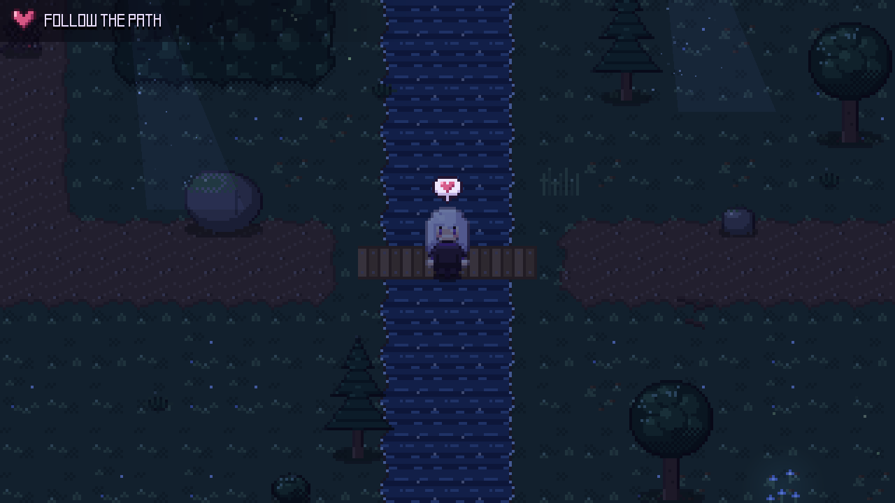
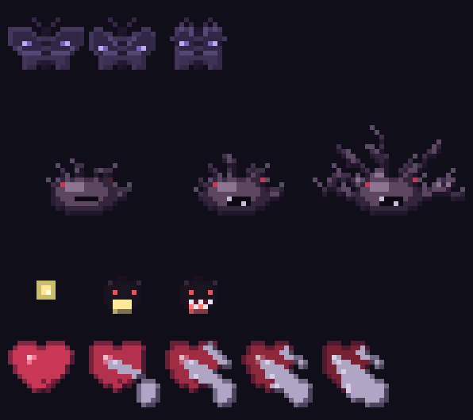

# game-dev-appunti

Il mio gioco in pixel art, fatto con Godot 4.7, e i pezzi riusabili che ne escono.

**Aletheia** (titolo provvisorio, sottotitolo *Death is a Lie*) è un action RPG breve-medio, a scelte, sulle
bugie. Lethe non esce dalla sua stanza da un giorno qualunque; una notte lo specchio coperto la porta in una
foresta dove ogni luogo è un oggetto della stanza, più grande. Dire la verità dà la luce (la magia), mentire
dà una spada di vetro che taglia anche lei. Il ritorno vero è aprire la porta.


## Cosa c'è già

| | |
| --- | --- |
| **Titolo** | Lethe di spalle davanti alla porta chiusa, la luna da una parte e la luce sotto la porta dall'altra; ogni tanto bussano. Continue / New Game / Talk to Someone / Quit. La prima volta, un avviso calmo sui temi del gioco. |
| **Cutscene** | Il calendario al buio, barrato fino al giorno cerchiato, e sotto *"tomorrow I'll go out."*, ripetuto, sempre più sbiadito. |
| **Prologo, la stanza** | Ci si sveglia, si guardano le cose (ogni oggetto racconta), bussano alla porta: la prima scelta tra verità e bugia. Poi lo specchio chiama, e Lethe cade dentro. |
| **Capitolo 1, la foresta** | La prima zona: bosco fitto, il primo ruscello del Lete, rovi, uno specchio dove riposarsi. Si combatte. |
| **Combattimento** | La spada di vetro (con mira assistita), la vita a cuore stretto da una mano, tre nemici a tema, esperienza e livelli, la morte (*"Death is a lie."*) e un segreto alla decima. |



**I nemici** (capitolo 1): la falena d'ombra, che va verso la luce; il rovo che sussurra le bugie di Lethe e
frusta; la lucciola falsa, una luce che mente.



## Provarlo

Serve [Godot 4.7](https://godotengine.org/download). `$GODOT` qui sotto è il percorso dell'eseguibile.

```sh
cd stanza
$GODOT --path .                                          # gioca
$GODOT --headless --path . -s res://tests/run_tests.gd   # i test (più di 200)
```

I tasti non sono scritti a schermo: il gioco li spiega quando servono.

| Tasto | Azione |
| --- | --- |
| WASD / frecce | cammina (8 direzioni) |
| Shift | corri |
| E / Z / Invio | parla con quello che c'è davanti, vai avanti nei dialoghi |
| K | la spada di vetro (da quando Lethe ha la scheggia dello specchio) |
| Spazio / J | la magia (quando Lethe la impara: arriva con la prima verità) |
| Esc / X | menu di pausa: oggetti, incantesimi, equipaggiamento, stato, salvataggi |

## Le cartelle

| Cartella | Cos'è |
| --- | --- |
| [stanza](stanza/) | Il gioco. Il [README della stanza](stanza/README.md) spiega com'è fatto, file per file. |
| [intro-studio](intro-studio/) | L'intro dello studio (la luna che guarda), da copiare all'inizio di ogni gioco, con i suoi test. |
| [Vault Gioco delle Bugie](Vault%20Gioco%20delle%20Bugie/) | Vault Obsidian con trama, meccaniche, nemici, musica e idee. Si apre con *Obsidian → Apri cartella come vault* e si parte da `00 Home/🏠 Home.md`. |
| [docs](docs/) | Le immagini di questo README: titolo, stanza, foresta, nemici, oggetti. |

## I temi

Il gioco parla di isolamento, disperazione e pensieri suicidi, e soprattutto di come uscirne. Non li mostra
mai: sono simboli (il Lete, il fiume che fa dimenticare). Le regole che il gioco segue sono nel vault, in
*Temi delicati - linee guida*. Nel menu del titolo c'è sempre **Talk to Someone**, con i numeri d'aiuto.

## Crediti

- Base dei personaggi: [Character Templates Pack](https://erisesra.itch.io/character-templates-pack) di Eris Esra
  (dettagli e licenza nel [README della stanza](stanza/README.md#sprite-della-protagonista))
- Font: Kenney Pixel ([kenney.nl](https://www.kenney.nl), CC0)
- Dialoghi: [Dialogue Manager](https://github.com/nathanhoad/godot_dialogue_manager) di Nathan Hoad (MIT)
- Tile della stanza e della foresta, nemici, oggetti, effetti, spada, musiche e suoni: fatti da zero per il gioco
