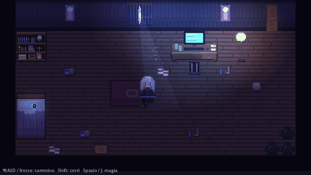

# game-dev-appunti

Appunti e pezzi riusabili per i miei giochi.

## Contenuto

- **[Vault Gioco delle Bugie](Vault%20Gioco%20delle%20Bugie/)**: vault Obsidian con le idee per il prossimo
  gioco (un gioco a scelte sulle bugie, in pixel art). Si apre con *Obsidian → Apri cartella come vault*;
  si parte da `00 Home/🏠 Home.md`.
- **[intro-studio](intro-studio/)**: progetto Godot 4.7 con l'intro dello studio (la luna che guarda),
  da copiare all'inizio di ogni gioco. Con test e generatori degli asset.
- **[stanza](stanza/)**: progetto Godot 4.7, la stanza di un hikikomori di notte. La protagonista
  cammina, corre e lancia magie che illuminano la stanza. Tileset ed effetti disegnati da zero.

## La protagonista nella stanza

Capelli bianchi lunghi, occhi viola, vestito nero e viola. Cammina in 8 direzioni, corre, e lancia
una magia: la carica sulle mani, poi il proiettile parte verso dove guarda e illumina di viola la
stanza buia, rischiarata solo dal monitor, dalla lampada e da uno spiraglio di luna tra le tende.

Gli sprite della protagonista restano in locale (derivano dal
[Character Template di Eris Esra](https://erisesra.itch.io/character-templates-pack)): dettagli nel
[README della stanza](stanza/README.md).

## Crediti

- Base dei personaggi: [Character Templates Pack](https://erisesra.itch.io/character-templates-pack) di Eris Esra
- Font dell'intro: Kenney Pixel ([kenney.nl](https://www.kenney.nl), CC0)
