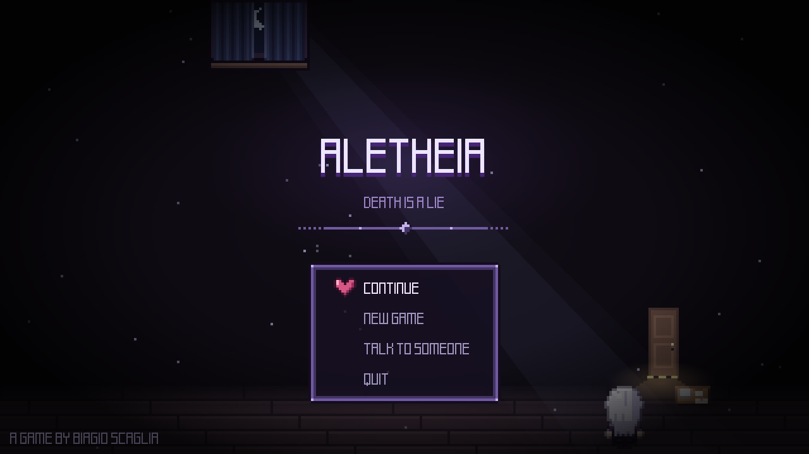
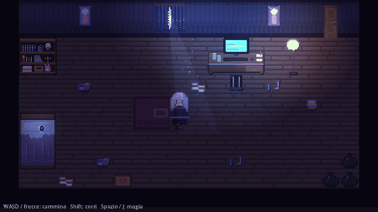

# stanza

Progetto Godot 4.7 del gioco (titolo provvisorio **Aletheia**, testi per ora in inglese): si apre
con l'intro dello studio, poi la schermata del titolo, poi la stanza di un hikikomori di notte.
La protagonista, Lethe, cammina in 8 direzioni, corre, lancia magie che illuminano la stanza e
fende con la spada di vetro dello specchio.





I tasti non sono scritti a schermo: il gioco li spiegherà man mano, quando servono (vedi il vault,
"Trama - bozza").

| Tasto | Azione |
| --- | --- |
| WASD / frecce | cammina |
| Shift | corri |
| Spazio / J | magia (carica sulle mani, poi il proiettile parte verso dove guarda); solo quando Lethe sa un incantesimo |
| K | spada di vetro (fende verso dove guarda); solo quando Lethe ha la spada in mano |
| Tab | solo in debug: cambia lo stadio della spada |
| Esc / X | menu di pausa (Esc, X o tasto destro: indietro) |
| E / Z / Invio | parla con la cosa davanti (sopra la testa di Lethe compare un fumetto col cuore); nei dialoghi: avanti |

## Comandi

`$GODOT` è il percorso dell'eseguibile di Godot 4.7; i comandi si lanciano da questa cartella.

```sh
$GODOT --path .                                                   # gioca
$GODOT --headless --path . -s res://tests/run_tests.gd            # test
$GODOT --path . -s res://tools/capture_frames.gd -- <cartella>    # screenshot automatici della stanza
$GODOT --path . -s res://tools/capture_frames.gd -- <cartella> - res://title/title_screen.tscn  # ...del titolo
```

## Com'è fatto

```
studio_intro/                    l'intro dello studio (copiata da ../intro-studio, sottotitolo "presents")
title/
├── title_screen.gd / .tscn      il titolo: Lethe davanti alla porta chiusa, la luna da una parte e la
│                                luce calda sotto la porta dall'altra. Appare dal nero, poi il menu
│                                Continue (se c'è un salvataggio) / New Game / Talk to Someone / Quit
│                                (Quit: lo schermo si rompe come in un incubo, poi si chiude)
├── title_door.gd                la porta: luce sotto, vassoio davanti; ogni tanto bussano e sotto
│                                compaiono i piedi
├── care_note.gd                 le pagine calme: l'avviso sui contenuti (la prima volta) e
│                                "Talk to Someone" coi numeri d'aiuto
├── title_backdrop.gd            raggio di luna (con le nuvole che passano) e pulviscolo
├── title_figure.gd              Lethe di spalle nel raggio (solo se ci sono i suoi sprite)
├── title_name.gd                il titolo col nome nascosto: ogni tanto di A-LETHE-IA resta solo LETHE
└── art/                         finestra con tende e luna, pavimento, pannello del menu, cuore,
                                 ornamento (dal generatore in locale: griglia a 16 px, blocchi 2x2)
ui/
├── heart_menu.gd                una lista di voci (Button veri: tastiera, gamepad, mouse): davanti
│                                alla voce scelta batte un cuore. La usano il titolo e il menu di pausa
└── fonts/                       Kenney Pixel (CC0)
main.tscn / main.gd              stanza al buio (CanvasModulate) + protagonista + OST
audio/stanza_theme.wav           l'OST della stanza: loop lo-fi di 25 s (dal generatore, senza stacchi)
audio/title_theme.wav            l'OST del titolo: il lamento di un giullare, valzer lento in Re minore
                                 su un carillon stonato, con sonagli e un bordone col tritono (44 s, loop)
audio/ui_move.wav, ui_confirm.wav  i suoni del menu (lamelle di carillon)
audio/sword_slash.wav            il fendente: sibilo, vetro che stride, schegge
audio/menu_*.wav                 i suoni del menu di pausa: oggetti che fanno rumore da soli (la porta, il
                                 telefono, lo specchio, il carillon, l'orologio) e il "no" basso e scordato
                                 (dal generatore in locale)
audio/magic_*.wav                i suoni della magia: il luccichio della carica, il soffio del lancio,
                                 il rintocco di vetro dell'impatto
world/
├── room_tiles.png / .json       atlante dei tile e i suoi dati (dal generatore)
├── room_tileset.gd              costruisce il TileSet dal JSON, con le collisioni
├── room_layout.gd               com'è arredata la stanza (solo dati)
├── room.gd                      dipinge i livelli (pavimento, muri, oggetti, mobili)
├── room_fx.gd                   luci, sfarfallio, schermo acceso, raggio di luna (dal JSON)
├── room_things.gd               le cose con cui si parla e quale c'è davanti a Lethe (solo logica)
└── door_knock.gd                dopo un po' bussano alla porta: il colpo, la luce e due piedi sotto la
                                 porta. Se Lethe va ad aprire una voce le chiede se è sveglia;
                                 se no, dopo qualche colpo se ne vanno
dialogue/
├── stanza.dialogue              cosa dicono le cose della stanza (Dialogue Manager): un cue per
│                                oggetto, col nome del suo tile. Le scelte cambiano truth / lies
├── dialogue_box.gd              il riquadro: testo a macchina da scrivere, il viso di Lethe quando
│                                pensa lei, le scelte col cuore, i suoni del carillon. Una riga
│                                col tag [#wrong] non va: si guasta tutta, il riquadro sobbalza,
│                                il carillon suona scordato
├── text_effects.gd, text_fx.gd  gli effetti sul testo per le righe che non vanno: [glitch] (le
│                                lettere diventano i segni del menu guasto), [shiver] (tremano a
│                                scatti di un pixel), [flicker] (si spengono). I conti in text_fx.gd
├── talk.gd                      l'iconcina sopra la testa di Lethe quando ha qualcosa davanti, apre il
│                                dialogo e ferma Lethe; conta le visite (seen("id") nei dialoghi)
└── talk_icon.png                l'iconcina: un fumetto col cuore che batte (2 fotogrammi, blocchi 2x2)
addons/dialogue_manager/         Dialogue Manager 4.2.0 di Nathan Hoad (MIT), senza i file C#
fx/
├── flicker.gd                   sfarfallio di una luce: tremolio + cali improvvisi
├── screen_glow.gd               lo schermo del PC che tremola, con la riga di scansione
├── moon_beam.gd                 il raggio di luna dalla tenda, con il pulviscolo
├── sparks.gd                    scintille di magia (scia e scoppio), quadratini da 2 pixel
├── screen_shake.gd              un piccolo tremolio dello schermo all'impatto
├── drop_shadow.gd               l'ombra sotto i piedi, a blocchi di 2 pixel come gli sprite
└── screen_shatter.gd            lo schermo che si rompe: crepe a ragnatela, frammenti che cadono
                                 nel buio, la musica che muore come un nastro, "Wake up, Lethe."
characters/protagonista/
├── facing.gd                    8 direzioni -> riga dello sheet + specchio (solo logica)
├── protagonista_frames.gd       animazioni dagli sheet (idle, walk, run, attack, slash x 5 direzioni)
├── protagonista.gd / .tscn      CharacterBody2D: movimento, corsa, magia e spada
└── sprites/                     gli sheet (idle, walk, run, attack, slash), vedi sotto
magic/
├── magic_frames.gd              animazioni di carica (8), proiettile (4), impatto (9), ognuna col suo ritmo
├── projectile.gd / .tscn        vola con una scia di scintille e una luce viola, esplode su muri e mobili
└── one_shot_effect.gd           carica e impatto: luce (sale nella carica, si spegne nell'impatto),
                                 suono, scoppio di scintille e tremolio a scelta
weapon/
├── glass_sword.gd / .tscn       un fendente: lama che compare e luccica, scia di vetro, schegge, suono;
│                                colpisce il livello "nemici" mentre la lama passa
├── sword_frames.gd              il fendente in tre stadi (scheggia, pugnale, lama) x 6 fotogrammi
└── sprites/                     lo sheet della spada (dal generatore in locale)
menu/
├── pause_menu.gd / .tscn        il menu di pausa stile RPG Maker: tiene insieme i pezzi, sceglie la pagina
├── menu_page.gd                 la base delle pagine a lista (titolo, lista col cuore, aiuto, "no")
├── party_view.gd, hero_card.gd  la pagina del gruppo (solo Lethe) e la sua riga (ritratto, barre)
├── items_view.gd                gli oggetti della stanza (riguardati, cambiano descrizione)
├── spells_view.gd               gli incantesimi: quale va su Spazio / J
├── equip_view.gd                arma, corpo, accessorio, con l'anteprima dei parametri
├── status_view.gd               parametri, equipaggiamento, incantesimo, verità e bugie
├── save_view.gd, save_store.gd  i 3 file di salvataggio (JSON in user://saves)
├── end_view.gd                  Game End: lo schermo si rompe e si torna al titolo
├── game_state.gd, equipment.gd  lo stato che si salva e i conti dei parametri (solo logica)
├── menu_data.gd                 tutti i testi e i numeri del menu (solo dati)
├── menu_style.gd, gauge.gd      tema, finestre, ritratti ritagliati dagli sheet, barre HP/MP
├── menu_glitcher.gd, glitch.gd  le scritte che si guastano per un attimo
├── menu_ambience.gd             gli oggetti della stanza che fanno rumore da soli, a menu aperto
├── menu_reactions.gd            il "no" sulle cose che non si possono, gli eventi dopo un salvataggio
└── menu_backdrop.gdshader       il gioco fermo dietro il menu: grigio, vignetta, righe, tremolio
core/
├── glow.gd                      luci morbide (PointLight2D a gradiente radiale)
├── music.gd                     musica in loop
├── sfx.gd                       suoni usa-e-getta (si liberano da soli, suonano anche in pausa)
├── settings_store.gd            le cose da ricordare che non sono un salvataggio (l'avviso già letto)
└── input_setup.gd               crea le azioni di input se mancano
tests/                           un file per modulo + mini runner headless
```

- **Luci**: la stanza è scurita da un `CanvasModulate`; schermo del PC, lampada, telefono e luna
  tra le tende hanno una `PointLight2D` che sfarfalla (lo schermo ha anche cali improvvisi, la
  lampada ogni tanto), e così il proiettile e l'impatto (viola).
- **Atmosfera**: lo schermo acceso tremola con una riga di scansione; dalla tenda scende un raggio
  di luna con il pulviscolo; l'OST lo-fi (piano elettrico, basso, batteria leggera, vinile) va in loop.
- **Protagonista**: disegnata sulla griglia 32x32 della sagoma e ingrandita a blocchi 2x2,
  senza dettagli a mezzo pixel: ha la stessa grana del pavimento. Sotto i piedi ha un'ombra
  scura e semitrasparente.
- **Stile dei tile**: come Lethe, una sola griglia a 16 px ingrandita a blocchi 2x2 (niente Scale2x
  né dettagli a mezzo pixel): contorno colorato, tre toni per materiale, riflessi, retinatura a scacchi.
- **Magia**: tre tempi, come nei campioni di incantesimi: la carica raccoglie scintille a spirale
  sulle mani (la luce sale, un luccichio sempre più acuto), il colpo parte con un lampo e un soffio e
  lascia una scia; all'impatto un lampo bianco, un anello che si allarga e si spezza in archi, uno
  scoppio di scintille, un piccolo tremolio e un rintocco di vetro. Sprite sulla griglia di Lethe,
  blend additivo (`CanvasItemMaterial` -> Add) per brillare.
- **Una stanza che racconta**: niente doppioni, solo oggetti che sono uno strato della storia (vedi
  il vault, "La stanza di Lethe"): lo specchio coperto da un lenzuolo, il calendario barrato fino a un
  giorno cerchiato, il vassoio intatto davanti alla porta, la foto a faccia in giù sul comodino, le
  palline di carta accanto alla scrivania, la pianta secca sotto la finestra.
- **Spada di vetro**: fatta del vetro dello specchio coperto (vedi il vault, "La spada di vetro"):
  ogni bugia ne stacca una scheggia, e la lama cresce in tre stadi. Lethe usa la posa d'attacco con
  la scia del braccio in vetro azzurro (la magia viola è la verità, la spada no).
- **All'inizio a mani vuote**: Lethe non sa incantesimi e non ha la spada (arrivano nella
  foresta, vedi il vault, "Trama - bozza"): nella stanza Spazio / J e K non fanno niente, e nel
  menu incantesimi ed equipaggiamento non ancora trovati sono "???". Addosso ha solo il vestito.
  Lo stato della partita sa cosa ha imparato e trovato (`learn`, `give`) e lo salva.
- **Menu di pausa**: come in RPG Maker, con il cuore del titolo come cursore. Oggetti, incantesimi
  (quale parte con Spazio / J), equipaggiamento con l'anteprima dei parametri, stato, salvataggi.
  In fondo una barra d'aiuto dice cosa fa quello che si guarda e quali tasti usare. Per ora
  parametri, armi diverse dalla spada e incantesimi scelti si vedono solo nel menu: il
  combattimento non li usa ancora. E qualcosa non va: il gioco dietro si fa grigio e trema, la
  musica rallenta e stona, le scritte si guastano per un attimo (mai l'aiuto), lo stato a volte
  legge "Dead", Lethe a volte è di spalle, gli oggetti riguardati cambiano descrizione, e il
  File 3 non è suo. Ogni tanto gli oggetti della stanza fanno rumore da soli:
  bussano alla porta, il telefono vibra, lo specchio si incrina, il carillon suona, l'orologio si ferma. Scegliere una cosa
  che non si può (un incantesimo non imparato, usare un oggetto, uno slot vuoto) dà un "no" basso:
  la voce si fa rossa, la finestra sobbalza, a volte compare "STOP.". Dopo un salvataggio, a volte,
  succede qualcosa: bussano, il file per un attimo è di qualcun altro, "She saw you save.".
  Game End rompe lo schermo come il Quit del titolo.
- **Profondità**: il livello dei mobili è ordinato per Y insieme alla protagonista, che passa
  davanti o dietro a seconda di dove sta.

## Sprite della protagonista

Gli sheet in `characters/protagonista/sprites/` sono Lethe ridisegnata sopra il
[Character Templates Pack di Eris Esra](https://erisesra.itch.io/character-templates-pack). La
licenza permette di usare i template nei giochi, commerciali e non; nei progetti gratuiti chiede
di citare l'autrice con il link al template (fatto qui e nei crediti). Non permette di rivenderli,
nemmeno modificati, né di usarli per asset pack o commissioni: questi sprite sono parte del gioco,
non un pacchetto a sé.

Il tileset, gli effetti magici e la spada invece sono disegnati da zero (generatori in locale).
